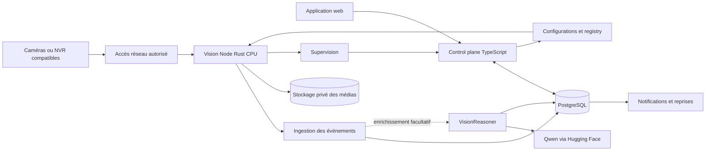

# Architecture cible — Pretorian v2

**Spécification proposée, pas état du code livré.** Les choix fermes et les hypothèses figurent dans [DECISIONS.md](DECISIONS.md). Les exemples de configuration ne sont pas encore un schéma accepté par un binaire.

## 1. Vue d'ensemble



**Cloud MVP :** le Vision Node s'exécute sur notre VM. **Edge possible :** le même cœur s'exécute sur site et remonte événements, métriques et médias autorisés. Les flèches sont logiques : les commandes edge passent par une connexion initiée par le node, et non par un port entrant ouvert chez le client.

## 2. Déploiement initial

```text
VM Pretorian
├── reverse proxy / TLS
├── web Next.js
├── API Bun/Hono
├── PostgreSQL : configuration, événements, outbox, audit
├── worker notifications / enrichissement VLM
└── Vision Node Rust : processus ou conteneur isolé

Stockage objet privé : fournisseur à choisir
Service VLM : externe
```

Préserver des ressources pour l'API et PostgreSQL. Limiter CPU, mémoire, threads d'inférence, espace de spool et nombre de flux admis. Aucune taille de VM ni capacité caméra n'est garantie ici.

Redis est optionnel. Un outbox PostgreSQL et des jobs persistants peuvent suffire au MVP. Pas de Kafka/Kubernetes par défaut. Les responsabilités peuvent rester des modules plutôt que des microservices séparés.

L'évolution vers plusieurs workers conserve les mêmes contrats. Affectation site/caméra → worker avec bail, génération de configuration et mécanisme de fencing : un worker ancien ne doit pas continuer à produire des notifications actives après réaffectation.

## 3. Raccordement des caméras

Chemins possibles : VPN privé, connecteur sortant sur site, intégration VMS/fournisseur documentée, ou edge complet. Choisir une liste de protocoles, codecs et matériels réellement testés. Un site peut nécessiter un connecteur réseau même si l'inférence reste cloud.

Ne pas demander l'exposition publique de caméras ou de ports RTSP. Ne pas confondre une webcam exposée à un navigateur, un flux RTSP et une capture d'onglet.

La consultation live est un chemin séparé de l'inférence : passerelle vidéo et format navigateur à qualifier. Le scheduler ne doit pas dépendre d'un utilisateur regardant le direct.

En cloud, les flux transmis quittent le site : le coût réseau, la protection des images et la disponibilité de la liaison font partie de l'offre. En edge, l'analyse peut continuer hors ligne, mais les alertes distantes restent indisponibles sans connectivité ou canal alternatif.

## 4. Organisation du Vision Node

```text
pretorian-vision
├── camera/       RTSP, découverte compatible, reconnexion, santé
├── video/        GStreamer, décodage, timestamps, sampling, conversion
├── scheduler/    budgets, files bornées, concurrence, équité
├── inference/    interface et runtime effectivement retenu
├── models/       architectures/adaptateurs, poids, pré/posttraitement
├── tracking/     pistes temporaires par caméra
├── rules/        zones, lignes, horaires, persistance, agrégation
├── events/       candidats, événements, déduplication, outbox
├── media/        tampon, clips, quotas, purge
├── control/      enrôlement, desired/reported state, artefacts
└── telemetry/    métriques, journaux expurgés, tracing
```

Rust/Tokio/Serde/tracing sont proposés pour l'application ; GStreamer pour la vidéo. L'inférence CPU est confiée à des workers de calcul bornés, pas exécutée sans contrôle sur les threads asynchrones réseau. Réutiliser les sessions lorsque le runtime le permet, sans supposer `Send + Sync` ou une concurrence non documentée.

L'interface interne expose chargement, capacités, inférence, sortie typée et erreurs. Elle ne fait dépendre les règles ni des tenseurs Candle/Burn ni des types Tract. Les tâches de détection, pose et classification n'ont pas nécessairement la même sortie : prévoir une union typée plutôt qu'un universel `Vec<Detection>`.

## 5. Pipelines métier

### Security

```text
image échantillonnée → personnes/véhicules → suivi temporaire
→ zone/ligne + horaire + persistance → événement → notification
                                        └→ enrichissement VLM optionnel
```

Les identifiants de suivi sont locaux et éphémères, pas des identités de personnes. ByteTrack ou un équivalent est un candidat, avec implémentation et compatibilité à vérifier.

### PPE

Détecter les personnes ou utiliser un détecteur PPE multi-classes ; associer l'équipement à la bonne personne et au bon instant ; appliquer les règles seulement lorsque la zone pertinente du corps est observable. Une boîte casque quelconque dans l'image ne suffit pas.

Résultat métier : `compliant`, `non_compliant_candidate` ou `unknown`. Tête occultée, résolution insuffisante et personne tronquée doivent permettre `unknown`. Une absence de casque détecté ne vaut pas automatiquement absence de casque porté.

### Fire

Pipeline fumée/flammes **indépendant de la présence de personnes et d'un filtre de mouvement obligatoire**. Fixer ses propres cadences et règles temporelles après validation. Le VLM fournit un complément ; il ne doit pas être un veto silencieux ou une condition indispensable à une alerte critique.

### Pose et proximité

Une chute exige une séquence et une logique temporelle, pas une classe sur une image seulement. La proximité apparente en pixels n'est pas une distance physique : tout seuil de distance personnes/engins exige calibration ou validation géométrique adaptée.

## 6. Scheduler CPU

Exemple expérimental, non prescriptif :

```yaml
schema_status: proposal
camera_id: cam-example
sampling:
  idle_fps: 1
  active_fps: 5
  burst_fps: 10
  max_frame_age_ms: 1000
pipelines:
  - pack: security
    detector: general-candidate
  - pack: safety
    model: ppe-candidate
    trigger: person_observable_in_work_zone
reasoning:
  enabled: false # activer après validation fournisseur et politique de données
  model_id: Qwen/Qwen3-VL-4B-Instruct
  max_requests_per_hour: 100 # exemple de quota, pas un coût garanti
```

Chaque paramètre ci-dessus est à calibrer. Un burst peut dépasser le budget CPU : le node doit le refuser ou signaler un état dégradé, pas feindre le débit demandé.

Principes : files bornées, priorité aux images récentes pour la détection, mutualisation des modèles, concurrence limitée et budgets par tenant/caméra/pack. Les pipelines temporels doivent connaître les frames perdues et leurs intervalles réels ; ne pas supprimer arbitrairement des images en faisant croire à une séquence régulière.

Le coût total inclut décodage, conversion couleur, resize, copies, inférence et postprocessing. Réduire les FPS analysés après décodage ne supprime pas automatiquement le décodage ni le trafic amont. Choisir un sous-flux adapté ou agir sur la caméra lorsque possible. Un batch multicaméra n'est intéressant que si son attente respecte la latence cible.

## 7. Événements et médias

Distinguer : observation brute → candidat → événement selon règle versionnée → enrichissement éventuel → notification. Conserver dates de capture, d'analyse et d'ingestion séparément ; horodatage UTC et fuseau du site pour les horaires, y compris passages de minuit et changements d'heure.

Enveloppe minimale proposée :

```json
{
  "schema_version": 1,
  "event_id": "example-event-id",
  "organization_id": "example-org",
  "site_id": "example-site",
  "camera_id": "example-camera",
  "node_id": "example-node",
  "assignment_generation": 1,
  "type": "restricted_zone_presence",
  "status": "open",
  "started_at": "2026-09-23T16:00:00Z",
  "rule_version": "example-rule-v1",
  "model_revision": "PINNED_COMMIT_REQUIRED",
  "observations": [],
  "media_refs": [],
  "reasoning_status": "not_requested"
}
```

Ne pas calculer une « probabilité de danger » en multipliant naïvement les scores. Conserver les observations et les justifications des règles.

Envoi au moins une fois, acquittement après persistance, clé d'idempotence et déduplication. Transaction événement + outbox ; retries bornés, temporisation et file d'échec inspectable. Même identifiant pour enrichir un événement, pas une nouvelle alerte identique à chaque frame.

Tampon vidéo court, par exemple avant/après événement, configurable et borné. Préférer des segments compressés pour la preuve plutôt qu'une accumulation de frames HD décodées. Aligner la découpe sur la disponibilité réelle des images clés. La livraison d'une alerte prioritaire ne doit pas attendre la fin du clip post-événement.

Snapshots et clips : stockage privé, quotas, rétention, suppression, références autorisées et liens temporaires. Une politique edge locale ne signifie pas automatiquement qu'aucune image ne part au VLM ou à un canal de notification : chaque destination doit être explicite.

## 8. VisionReasoner externalisé

Interface fournisseur générique autour de Qwen. Envoyer seulement les images/extraits nécessaires et autorisés ; limiter taille, nombre d'images, tokens de sortie, concurrence, timeout, tentatives et coût par site.

Retour structuré proposé : statut `observed` / `not_observed` / `unknown`, explication courte, indices visuels, limites d'observation. Valider le JSON côté serveur ; ne pas présenter un score auto-déclaré comme calibré. Traiter tout texte contenu dans l'image et toute réponse modèle comme donnée non fiable, jamais comme instruction d'action.

Un timeout, un quota épuisé ou un fournisseur indisponible doit produire un événement non enrichi et une métrique. Pas de repli payant automatique. Aucune clé HF dans le navigateur ou les logs. Les décisions de traitement d'images par un tiers sont distinctes de la simple permission d'envoyer une alerte textuelle.

## 9. Registry et configurations

Le control plane publie un état désiré versionné : caméras affectées, modèles, packs, règles, politiques de données et budgets. Le node renvoie l'état observé : génération appliquée, flux réellement récents, modèles chargés, FPS effectifs, incidents et ressources.

Téléchargements d'artefacts approuvés avec hash, signature/chaîne de confiance et compatibilité vérifiée. Charger/tester avant activation ; swap atomique si les ressources le permettent ; conserver un rollback. Un échec ne détruit pas la dernière configuration valide.

Enrôlement par jeton temporaire, puis identité propre au node, renouvelable et révocable. Appels sortants HTTPS/WSS pour l'edge ; gRPC est une option, pas une dépendance MVP. Les endpoints de contrôle ne doivent pas donner un shell distant arbitraire.

## 10. Données et multi-tenant

```text
organization → memberships
organization → sites → cameras → pipeline configurations
organization → vision nodes → assignments / leases
models → model versions → approved artifacts
vision packs → model bindings / rule templates
sites/cameras → zones / schedules / rules
events → observations résumées / media / enrichments
notification channels → delivery attempts
node health / camera health / audit logs
```

Les nodes cloud peuvent être partagés physiquement : l'arbre organisation/site n'est pas une garantie d'isolation à lui seul. Chaque accès, job, média, secret et cache porte un périmètre tenant vérifié. Tests explicites d'accès inter-organisations ; politiques de base de données possibles en défense supplémentaire.

Les boîtes et pistes de chaque frame restent en mémoire ou dans un stockage local borné ; seuls événements, agrégats et métriques utiles remontent par défaut. Pas de table PostgreSQL alimentée sans limite par toutes les détections.

## 11. Santé, sécurité et confidentialité

Mesurer l'âge de la dernière image exploitable, pas seulement un heartbeat du processus. Détecter perte de flux, gel probable, corruption, retards, saturation, disque plein, échec de notification et dérive de configuration. États suggérés : `healthy`, `degraded`, `offline`, `unverified`.

Identifiants caméra en coffre ou chiffrés, jamais dans les logs/URLs affichées. Les URLs caméra créent un risque SSRF : limiter protocoles, destinations et routes au périmètre autorisé du site ; bloquer métadonnées cloud, localhost du worker et réseaux de management non autorisés. Les réseaux privés légitimes du client doivent être autorisés explicitement, pas ouverts sans contrôle à tous les tenants.

Pas d'exécution de code arbitraire téléchargé avec un modèle. Artefacts approuvés, conversions isolées et versions épinglées. Audit de secrets/historique des anciens dépôts avant relance, sans recopier ni réutiliser de secrets exposés.

Prévoir minimisation, masquage lorsque pertinent, durées de conservation, contrôle d'accès, traçabilité et dossier de conformité adapté au site. L'edge n'exonère pas de ces exigences. Ne pas réutiliser les images clients pour l'entraînement sans droits et autorisations distincts.

## 12. Organisation de code envisagée

```text
apps/web/                     # interface
apps/api/                     # contrôle SaaS
services/vision-node/         # binaire Rust
crates/pretorian-contracts/   # messages, configurations, événements
crates/pretorian-models/      # adaptateurs/architectures retenus
crates/pretorian-rules/       # règles testables
packages/schemas/             # schémas partagés TS/Rust
training/                     # Python hors chemin production
benchmarks/                   # mesures reproductibles
docs/pretorian-v2/            # ce dossier
infra/                        # conteneurs puis IaC
```

Cette arborescence est une cible de refonte. Ne pas déplacer ni supprimer la v1 sans plan de migration explicite. Les contrats, noms de commandes et APIs seront fixés dans les premiers jalons, pas déduits des exemples documentaires.
